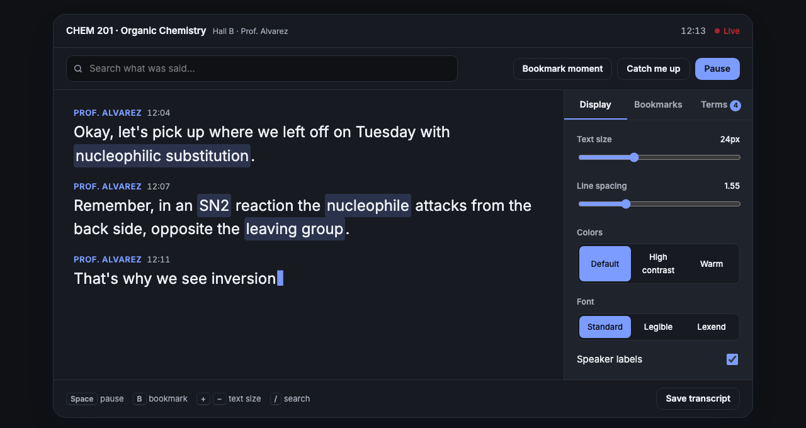

# Lectern

**Live lecture captions for deaf and hard-of-hearing students, running entirely on your laptop.**

Built at HackCampus 2026 · **Live demo:** https://lectern-captions.vercel.app



## The problem

Deaf and hard-of-hearing students usually get captions through a human CART captioner, which takes one to three weeks to schedule and costs $3,000–$9,000 per course. Until then, they lip-read from the front row. Auto-captions built into video-call apps don't help in an in-person lecture hall, and they send classroom audio to the cloud.

## What Lectern does

- **Live captions** with speaker labels and timestamps, under 400 ms behind the speaker
- **Course vocabulary**: terms from the syllabus are spelled correctly, highlighted, and explained in a live glossary
- **Exam flags**: lines like "this will be on the midterm" are tagged automatically
- **Catch me up**: a running summary for when you lose focus for a minute
- **Search and bookmarks** while the lecture is still going
- **Transcript export** with the summary, key terms and bookmarks
- **On-device only**: no audio or text leaves the laptop

## Accessibility

The demo itself is built to WCAG 2.2 AA:

- Adjustable text size, line spacing, high-contrast and warm color modes, and a choice of fonts (Inter, Atkinson Hyperlegible, Lexend). Settings persist per device.
- Captions are an ARIA live region; the side panel uses proper tab semantics with arrow-key navigation.
- Keyboard shortcuts: <kbd>Space</kbd> pause, <kbd>B</kbd> bookmark, <kbd>+</kbd>/<kbd>−</kbd> text size, <kbd>/</kbd> search.
- Respects `prefers-reduced-motion` (shows the full lecture instead of animating it) and `prefers-color-scheme`.
- Visible focus styles and a skip link.

## Try it

Open the [live demo](https://lectern-captions.vercel.app) and scroll to the caption window. A sample organic chemistry lecture plays automatically. Things to try:

1. Click a highlighted term to see its definition.
2. Press **B** to bookmark a line, then jump back to it from the Bookmarks tab.
3. Click **Catch me up**.
4. Switch to **High contrast** and the **Legible** font.
5. Click **Caption my mic** and talk (Chrome, Edge or Safari).
6. **Save transcript** at the end.

## Running locally

No build step or dependencies.

```bash
git clone https://github.com/devanshig16/lectern.git
cd lectern
python3 -m http.server 8000
# open http://localhost:8000
```

## How it's built

Plain HTML, CSS and JavaScript, so it loads instantly and runs anywhere.

```
index.html
css/
  base.css        design tokens (light + dark), nav, buttons, hero
  demo.css        caption viewer and side panel
  sections.css    how it works, privacy, comparison, FAQ, waitlist
js/
  data/           sample lecture, glossary, summary points
  core.js         caption engine; exposes formatters + hooks on window.Lectern
  settings.js     display settings, saved to localStorage
  tabs.js         accessible tabs
  glossary.js     term highlighting + live glossary
  search.js       transcript search
  bookmarks.js    bookmarks
  summary.js      "Catch me up" and exam flags
  transcript.js   .txt export
  mic.js          Web Speech API demo
  shortcuts.js    keyboard shortcuts
  waitlist.js     waitlist form
  main.js         starts the demo
```

`core.js` owns the caption loop. Each feature registers a **formatter** (to change how a line renders, e.g. highlighting terms or search matches) or a **hook** (`text`, `lineDone`, `reset`, `resume`) instead of calling other features directly, so features can be added or removed independently.

In the web demo, the sample lecture is scripted and "Caption my mic" uses the browser's speech engine. The product runs an on-device speech model (Whisper-class, quantized) with a custom vocabulary built from the syllabus.

## Roadmap

- Desktop app with the on-device model
- Slide sync: line transcripts up with uploaded slides
- Confidence highlighting for uncertain words
- Pilot with three disability services offices in spring 2027

## Team

Built in 36 hours at HackCampus 2026.

## License

MIT
